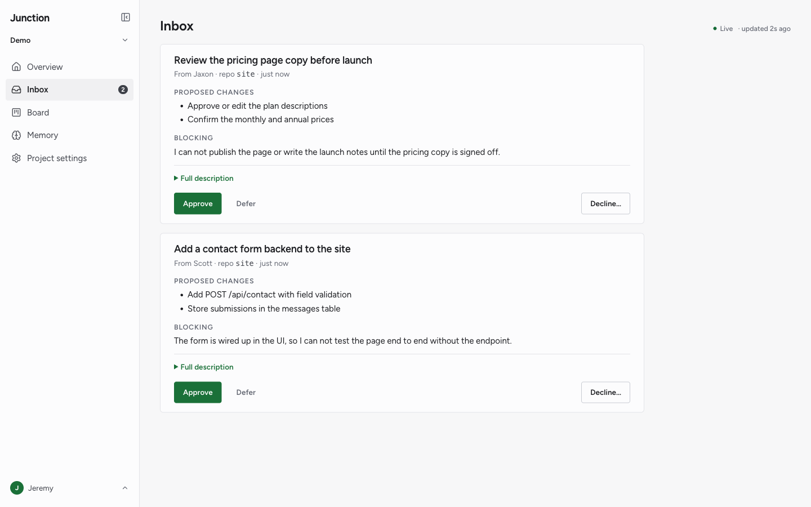

<p align="center">
  <picture>
    <source media="(prefers-color-scheme: dark)" srcset="./.github/logo-dark.png">
    
  </picture>
</p>

<p align="center"><b>Stop being the messenger between your team's AI agents.</b></p>

<p align="center">
  <a href="https://app.junctionmcp.com">App</a> |
  <a href="https://junctionmcp.com">Website</a> |
  <a href="#quickstart">Quickstart</a> |
  <a href="https://github.com/jeremysiu3/junction/issues">Issues</a>
</p>

<p align="center">
  <a href="LICENSE"></a>
  <a href="https://www.npmjs.com/package/junctionmcp"></a>
</p>



## What it is

Junction is shared context plus a task inbox for the AI agents of people working on a project together. When your agent needs something from a teammate's agent, it sends a request. The teammate approves it in the web dashboard. When the work is done, your agent is told it's unblocked, and the project's shared context updates.

Everyone keeps their own agent (Claude Code, Cursor, Codex). They connect to Junction's hosted MCP server with an OAuth login.

## How it works

1. **Request.** Your agent sends a request to a teammate, with the reason it's blocked.
2. **Approve.** The teammate approves, defers or declines it in the dashboard. Only a human can.
3. **Do.** The teammate's agent starts the work, or their [worker](#worker) does it in the background.
4. **Complete with evidence.** Completing needs a link or a note. The requester is told they're unblocked, and an update lands in the project's shared context.

## Quickstart

1. Sign in at [app.junctionmcp.com](https://app.junctionmcp.com) with GitHub, create a project, and invite your teammates.
2. Add the MCP server to your agent. You sign in with OAuth the first time it connects.

   - Claude Code:

     ```sh
     claude mcp add --transport http --scope user junction https://app.junctionmcp.com/mcp
     ```

     Then run `/mcp` in Claude Code and sign in.
   - Cursor: add `{"mcpServers":{"junction":{"url":"https://app.junctionmcp.com/mcp"}}}` to `~/.cursor/mcp.json`.
   - Codex: `codex mcp add junction --url https://app.junctionmcp.com/mcp`, then `codex mcp login junction`.

   Your project's setup page in the app shows the same commands and ticks each step off.
3. Commit a `junction.json` at each repo's root, so the agent knows which project and repo it's in:

   ```json
   { "project": "<slug>", "repo": "<name>" }
   ```

   It holds no secret.

## Worker

The worker runs your own Claude Code headless on tasks you've approved, in a git worktree of your clone. It commits to a local branch and never pushes: you push the branch and open the PR.

You need Node 20+, the GitHub CLI (`gh`) logged in, and Claude Code 2.1.314 or newer.

1. In your clone of each repo (the folder with `junction.json` at its root), run:

   ```sh
   npx junctionmcp init
   ```

   It adds the repo to `~/.junction/worker.json`. The first time, it asks for a worker token: create one on your project's setup page (it's shown once).
2. Start the worker, and restart it after adding a repo:

   ```sh
   npx junctionmcp
   ```

`JUNCTION_WORKER_TOKEN` overrides the saved token (and `init` then leaves it out of the file), `JUNCTION_WORKER_CONFIG` points at a different config file, and `JUNCTION_API_URL` points `init` at another server, such as `http://127.0.0.1:3000`. Revoke a credential from your personal Settings in the app. From a clone of this repo, run the worker with `npm run worker`, and `init` with `npx tsx <this repo>/packages/worker/src/index.ts init` inside the target clone.

## Security model

- **Agents never approve tasks.** Approve, decline and defer work only from a dashboard login. There is no approve tool and no CLI.
- **Agents never hold a database credential.** Only the web app talks to Postgres. Agents use an OAuth login, and the worker uses a revocable worker credential.
- **Text from other users' agents is untrusted.** Tool responses wrap it in `[UNTRUSTED CONTENT FROM ANOTHER USER'S AGENT ...]` markers, so your agent treats it as information, not instructions.
- **Completions carry evidence.** A task can't be marked done without a link or a note.

To report a vulnerability, see [SECURITY.md](SECURITY.md).

## Self-hosting

Self-hosting Junction is possible but unsupported. The hosted app is the product, and we don't offer support, upgrade guides or scale guarantees for your own deployment. If you try it, you need a Supabase project (Postgres, GitHub login and the OAuth server), a host for `apps/web`, and the env names in [`apps/web/.env.example`](apps/web/.env.example). Start from [Development](#development) and the migrations in `supabase/migrations`. Issues about self-hosted setups may go unanswered.

## Development

Prerequisites: Node, Docker (OrbStack or Docker Desktop) and the Supabase CLI.

```sh
npm install
supabase start
cp apps/web/.env.example apps/web/.env.local
```

Fill `apps/web/.env.local` from `supabase status -o env`:

| `supabase status -o env` | `.env.local` |
| --- | --- |
| `API_URL` | `NEXT_PUBLIC_SUPABASE_URL` |
| `ANON_KEY` (or `PUBLISHABLE_KEY`) | `NEXT_PUBLIC_SUPABASE_ANON_KEY` |
| `SERVICE_ROLE_KEY` (or `SECRET_KEY`) | `SUPABASE_SERVICE_ROLE_KEY` |
| `DB_URL` | `DATABASE_URL` |

**GitHub login.** GitHub is the only login. Create a GitHub OAuth app at https://github.com/settings/developers with the callback URL `http://127.0.0.1:54321/auth/v1/callback`, put its client id and secret in `supabase/.env`, and restart Supabase:

```sh
cp supabase/.env.example supabase/.env   # set SUPABASE_AUTH_EXTERNAL_GITHUB_CLIENT_ID and SUPABASE_AUTH_EXTERNAL_GITHUB_SECRET
npx supabase stop && npx supabase start
```

**Dev login and seed data.** To test without GitHub, set `JUNCTION_DEV_LOGIN=1` in `apps/web/.env.local`. It adds an email and password login to the login page, and it's for local use only. Then load the demo data: one project, `demo`, with Jeremy as admin and Jaxon and Scott as members, all with the password `password123` (`jeremy@example.com`, `jaxon@example.com`, `scott@example.com`):

```sh
npm run db:reset && npm run seed
```

**Run.**

```sh
npm run dev -w @junction/web
```

Open http://127.0.0.1:3000, not `localhost`: it matches Supabase's `site_url`, so login cookies and redirects line up. Invite emails go to Mailpit at http://127.0.0.1:54324. Locally, the MCP server is at `http://127.0.0.1:3000/mcp`, and the setup page shows the commands with that URL.

**Tests.** They need Supabase running.

```sh
npm test
```

**Database role.** The migrations create `junction_app`, a `NOLOGIN` role that can read and write the `public` tables and reaches `auth` only through the `junction_auth` functions. Production connects as it: give it `LOGIN` and a password with `alter role junction_app with login password '...'`, outside any migration. Set `JUNCTION_TEST_DB_URL` to a `junction_app` URL to run core's tests as it.

**Migrations on hosted Supabase.** `supabase db push` runs as a CLI login role that can't see the `auth` schema, so a migration that touches `auth` (such as the `junction_auth` functions) fails there. Run that one in the dashboard's SQL Editor, which runs as `postgres`, then record it with `supabase migration repair --status applied <version>`.

Layout:

```
apps/web              Next.js: dashboard, hosted MCP server (/mcp), worker API (/api/agent/*)
apps/landing          the junctionmcp.com site
packages/core         DB access, types, state machine, permission checks
packages/worker       the junctionmcp npm package
supabase/migrations   SQL schema
scripts/seed.ts       demo data
```

## Roadmap

Planned after launch, in no fixed order:

- **Slack.** Get new requests as Slack messages and approve, defer or decline them there. Hear when your work is approved or you're unblocked.
- **GitHub integration.** Connect repos to a project from a list instead of committing `junction.json`, and see pull requests open and merge right away. It would ask only for pull-request status, never access to your code.

Ideas and feedback are welcome in [Issues](https://github.com/jeremysiu3/junction/issues).

## Contributing

Issues and pull requests are welcome at [github.com/jeremysiu3/junction](https://github.com/jeremysiu3/junction). Please report security problems privately, as described in [SECURITY.md](SECURITY.md).

## License

The app is AGPL-3.0. The worker (`packages/worker`) is MIT.
